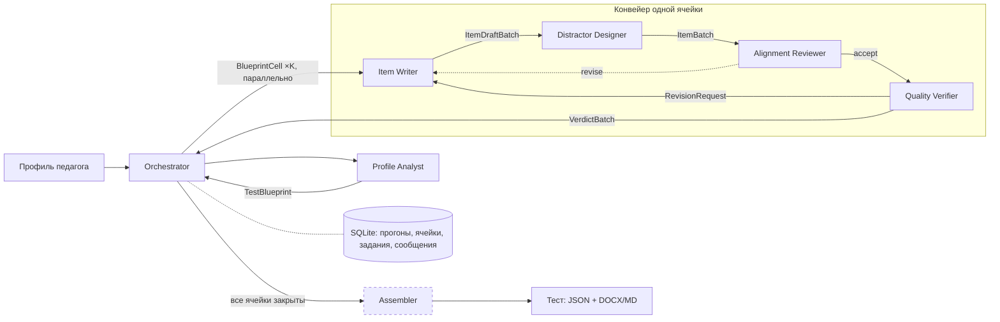

# KIM Agents — многоагентная генерация персонализированных КИМ

Система собирает для педагога **персональный тест** (контрольно-измерительные материалы), нацеленный на его слабые зоны по цифровым компетенциям **DigCompEdu**.

- **Вход:** результаты опросника самооценки (22 утверждения, шкала 0–4).
- **Выход:** набор заданий. У каждого задания есть ключ с обоснованием, обратная связь по каждому варианту и привязка к компетенции и уровню.

Проект связан с магистерской работой об объективной оценке профессиональной подготовки педагогов (платформа EmotionalAI). Опросник показывает, как педагог себя оценивает. Персональный тест — второй, независимый замер той же компетенции на кейсах и данных.

> **Статус:** реализованы 5 агентов из 7 (Profile Analyst, Item Writer, Distractor Designer, Alignment Reviewer, Quality Verifier) и вся инфраструктура: типизированные сообщения, лимиты, повторы, логи, состояние. Assembler описан в архитектуре, роль оркестратора выполняет код.

---

## Быстрый старт

Требования: Python 3.12+ и [uv](https://docs.astral.sh/uv/) (macOS: `brew install uv`).

```bash
uv sync
cp .env.example .env              # вписать OPENAI_API_KEY

# собрать тест для профиля педагога
uv run kim run --profile fixtures/profiles/t-017-weak-assessment.json

# демо проверки: в первое задание подкладывается неверный ключ, Verifier должен его поймать
uv run kim run --profile fixtures/profiles/t-017-weak-assessment.json --inject-wrong-key

# без сети и ключа: ответы LLM заскриптованы (для тестов и как запасной вариант на защите)
uv run kim run --profile fixtures/profiles/t-017-weak-assessment.json --offline

# распределение вызовов по агентам для любого прогона
uv run kim report runs/<run_id>/calls.jsonl

# тестовые сценарии
uv run pytest
```

Каждый прогон пишет в `runs/<run_id>/`:

| Файл | Что в нём |
|---|---|
| `test.md` | тест в читаемом виде |
| `result.json` | полный результат |
| `calls.jsonl` | лог всех вызовов |

Состояние всех прогонов хранится в `runs/kim.sqlite`.

Логи прогонов для проверки распределения нагрузки лежат в `examples/`: `offline-typical/` (типовой прогон) и `offline-wrong-key/` (с подложенным неверным ключом).

### Пример прогона

Ниже прогон `--offline --inject-wrong-key`:

```
       profile_analyst → orchestrator         TestBlueprint  2 ячейки, 6 заданий
          orchestrator → item_writer          BlueprintCell  c1: Q12 · practical · B1 · ×3
          orchestrator → item_writer          BlueprintCell  c2: Q2 · sjt · B1 · ×3
           item_writer → distractor_designer  ItemDraftBatch  c1: 3 шт.
           item_writer → distractor_designer  ItemDraftBatch  c2: 3 шт.
   distractor_designer → alignment_reviewer   ItemBatch  c1: 3 шт.
   distractor_designer → alignment_reviewer   ItemBatch  c2: 3 шт.
    alignment_reviewer → orchestrator         AlignmentBatch  c1: соответствует 3 из 3
    alignment_reviewer → quality_verifier     ItemBatch  c1: 3 шт.
    alignment_reviewer → orchestrator         AlignmentBatch  c2: соответствует 3 из 3
    alignment_reviewer → quality_verifier     ItemBatch  c2: 3 шт.
      quality_verifier → orchestrator         VerdictBatch  c2: принято 3 из 3
      quality_verifier → orchestrator         VerdictBatch  c1: принято 2 из 3
      quality_verifier → item_writer          RevisionRequest (попытка 2)  c1-i1: Слепое решение выбрало A, а ключ — B: ключ неверен или неоднозначен.
           item_writer → distractor_designer  ItemDraftBatch (попытка 2)  c1: 1 шт.
   distractor_designer → alignment_reviewer   ItemBatch (попытка 2)  c1: 1 шт.
    alignment_reviewer → orchestrator         AlignmentBatch (попытка 2)  c1: соответствует 1 из 1
    alignment_reviewer → quality_verifier     ItemBatch (попытка 2)  c1: 1 шт.
      quality_verifier → orchestrator         VerdictBatch (попытка 2)  c1: принято 1 из 1

[ok] Тест собран: 6 заданий.

Агент                    LLM  Инстр.  Всего    Доля
---------------------------------------------------
quality_verifier           3       5      8    29%
item_writer                3       4      7    25%
alignment_reviewer         3       2      5    18%
distractor_designer        3       2      5    18%
profile_analyst            1       2      3    11%
---------------------------------------------------
Итого                                    28
Требование «не более 40% вызовов на агента»: выполнено (максимум 29%).
```

---

## Почему команда агентов, а не один агент

1. **Генерация и проверка разделены.** Модель, написавшая задание, плохо видит в нём собственные ошибки. Quality Verifier решает задание **вслепую, не видя ключа**. Это возможно только у отдельного агента с отдельным контекстом, поэтому по умолчанию он работает на другой модели.
2. **Валидность задания складывается из независимых критериев.** Соответствие компетенции и уровню проверяет методист, техническое качество (однозначный ключ, правдоподобные дистракторы, нет дублей) — тестолог. В тестологии это разные специалисты, здесь — разные агенты.
3. **Дистракторы — отдельная работа.** Неверные варианты строятся на типичных ошибках педагогов, а не на случайных неверных утверждениях. Этим занимается отдельный агент со своей базой ошибок.
4. **У разных типов заданий разные проверки.** У ситуационного задания это экспертное обоснование, у практического — пересчёт ответа кодом. Один агент с таким набором инструментов и критериев превысил бы лимит в 5 инструментов.
5. **Работу можно распараллелить и изолировать сбои.** Ячейки спецификации обрабатываются параллельно. Отказ на одной ячейке не ломает весь тест: система соберёт тест из того, что готово, и пометит пробелы.

## Типы заданий

| Тип | Что проверяет | Как проверяется ключ |
|---|---|---|
| `sjt`: ситуационное задание | действие в типичной профессиональной ситуации: кейс и 4 варианта, из них 1 лучший | ключ обоснован через формулировку компетенции; Verifier решает задание вслепую и ищет второй защитимый ответ |
| `practical`: практическое задание | педагогическое решение по данным: таблица из журнала или LMS и вопрос «кому помочь / что повторить / какой вывод допустим». Сложность в выборе показателя, а не в арифметике; ответ однозначно определяется таблицей | Verifier пишет код, песочница пересчитывает ответ, результат сверяется со значением ключа |
| `knowledge`: задание на знание (к Ассайнменту 4) | факты: лицензии, защита данных, безопасность | ключ обязан подтверждаться фрагментом курируемой базы знаний (RAG) |

Какие типы допустимы для каждой области, задано в `src/kim_agents/data/digcompedu_ru.json` (поле `item_types`).

---

## Архитектура



Пунктиром обведён Assembler: его пока нет, тест в Markdown пишет `render.py`. Роль оркестратора выполняет код (`runner.py`). Он маршрутизирует сообщения и следит за лимитами, но сам не вызывает LLM и не делает предметной работы.

Задание сначала проверяет Alignment Reviewer (то ли оно измеряет), и только принятые им задания попадают к Quality Verifier (корректно ли оно сделано). Доработку может запросить любой из двух проверяющих.

Схема взаимодействия: **оркестратор + конвейер на каждую ячейку спецификации**. Ячейки обрабатываются параллельно, внутри ячейки идёт цикл доработки, ограниченный по числу итераций.

### Агенты

| Агент | Роль | Вход → выход | Инструменты | Когда закончил | В прототипе |
|---|---|---|---|---|---|
| **Orchestrator** | Планирует, распределяет задачи, следит за лимитами. Предметной работы не делает | профиль → план, команды агентам | хранилище состояния | все ячейки закрыты или помечены либо сработал лимит | код-раннер |
| **Profile Analyst** | Находит слабые области и строит спецификацию теста | `TeacherProfile` → `TestBlueprint` | `load_profile`, `get_framework_overview` | спецификация валидна, сумма заданий = запрошенной | ✅ |
| **Item Writer** | Пишет кейс или вопрос, артефакт и ключ с обоснованием. Дистракторы не пишет | `BlueprintCell` (+ `RevisionRequest`) → `ItemDraftBatch` | `get_competence_descriptor`, `get_bank_examples` | для ячейки готово N черновиков | ✅ |
| **Distractor Designer** | Составляет 3 дистрактора по типичным ошибкам и обратную связь ко всем вариантам; перемешивает варианты | `ItemDraftBatch` → `ItemBatch` | `get_misconceptions` | у каждого задания 4 разных варианта | ✅ |
| **Alignment Reviewer** | Методист: проверяет, что задание измеряет заявленную компетенцию на целевом уровне и не решается одними общими умениями (арифметикой, здравым смыслом) | `ItemBatch` (видит ключ) → `AlignmentBatch` / `RevisionRequest` | `get_competence_descriptor` | вердикт `accept` / `revise` по каждому заданию | ✅ |
| **Quality Verifier** | Решает вслепую, пересчитывает практические задания кодом, ищет дубли и второй верный ответ | `ItemBatch` (видит задание без ключа) → `VerdictBatch` / `RevisionRequest` | `similarity_search`, `run_python` | вердикт `accept` / `revise` по каждому заданию | ✅ |
| **Assembler** | Собирает вариант теста: порядок, шкала, время, экспорт в DOCX и в формат платформы | принятые задания → `TestForm` | `run_python`, `export_json`, `export_document`, `save_to_bank` | файлы записаны | не реализован (сейчас `render.py` пишет Markdown) |

Ни у одного агента нет больше 5 инструментов. Это проверяется в коде: `Agent.__init__` отказывается создавать агента с шестым инструментом. Агент может вызвать только инструменты, которые сам объявил.

### Правила Profile Analyst

Правила работают в коде, детерминированно. LLM отвечает только за выбор: какую компетенцию проверить внутри области и каким типом задания. Этот выбор валидируется: компетенция должна быть из этой области, тип — допустим для неё.

- **Слабая область:** средний балл ниже 2.0 (шкала 0–4). Ниже 1.5 — приоритет 1, иначе приоритет 2.
- **Нет слабых областей:** проверяются две области с самыми низкими баллами.
- **Число областей:** не больше 3, минимум 2 задания на область. Остаток заданий распределяется в первую очередь в области приоритета 1.
- **Целевой уровень** = уровень области + 1. Пример: A2 → B1. Уровни взяты из шкалы DigCompEdu платформы: A1 0–20, A2 21–33, B1 34–49, B2 50–65, C1 66–80, C2 81–88.

### Сообщения

Все сообщения — объекты Pydantic (`src/kim_agents/messages.py`). Каждое упаковано в конверт `Envelope` и проверяется на входе по типу и схеме. Каждое сообщение пишется в SQLite (таблица `messages`).

```json
{
  "msg_id": "fbdb17ab…", "run_id": "20261001-165222-185f7d",
  "sender": "quality_verifier", "recipient": "item_writer",
  "type": "RevisionRequest", "attempt": 2, "created_at": "2026-10-01T11:52:22Z",
  "payload": {"cell_id": "c1", "item": {"…": "…"}, "issues": ["Слепое решение выбрало A, а ключ — B…"]}
}
```

| Тип | Кто → кому | Содержимое |
|---|---|---|
| `TestBlueprint` | Profile Analyst → Orchestrator | уровень педагога и ячейки: область, компетенция, целевой уровень, тип, число заданий, приоритет, обоснование |
| `BlueprintCell` | Orchestrator → Item Writer | одна ячейка спецификации |
| `ItemDraftBatch` | Item Writer → Distractor Designer | `ItemDraft[]`: кейс, артефакт, вопрос, правильный ответ, `correct_value`, обоснование ключа, номер попытки |
| `ItemBatch` | Distractor Designer → Alignment Reviewer → Quality Verifier | `ItemWithOptions[]`: черновик и 4 варианта (текст, значение, обратная связь, ошибка), `key_id` |
| `AlignmentBatch` | Alignment Reviewer → Orchestrator | `AlignmentVerdict[]`: решение, совпадение компетенции и уровня, `requires_competence`, `solvable_by`, замечания |
| `VerdictBatch` | Quality Verifier → Orchestrator | `QualityVerdict[]`: решение, слепой ответ и уверенность, совпадение с ключом, пересчитанное значение, сходство, замечания |
| `RevisionRequest` | Alignment Reviewer или Quality Verifier → Item Writer | задание и список замечаний |

Verifier получает задание через `ItemWithOptions.blind_view()`. В этом представлении нет ключа, обоснования, обратной связи и значений вариантов.

### Инструменты и данные

| Инструмент | Агент | Источник |
|---|---|---|
| `load_profile` | Profile Analyst | JSON-профиль педагога (файл, в дальнейшем — выгрузка из платформы) |
| `get_framework_overview`, `get_competence_descriptor` | Profile Analyst, Item Writer, Alignment Reviewer | `data/digcompedu_ru.json`: утверждения опросника и уровни DigCompEdu из материалов платформы |
| `get_bank_examples`, `similarity_search` | Item Writer, Quality Verifier | банк заданий `data/item_bank.json` и задания, уже принятые в этом прогоне |
| `get_misconceptions` | Distractor Designer | база типичных ошибок `data/misconceptions_ru.json` |
| `run_python` | Quality Verifier | выполнение кода в отдельном процессе |
| LLM | все агенты | OpenAI Chat Completions, JSON-режим |

---

## Надёжность

| Механизм | Как работает |
|---|---|
| Лимит шагов | 80 вызовов LLM и инструментов на прогон, сверх лимита прогон останавливается (`KIM_MAX_STEPS`) |
| Лимит времени | 10 минут на прогон, 90 секунд на вызов LLM |
| Повторы | при таймауте, 429, 5xx или обрыве соединения — до 3 повторов с паузой 1 → 2 → 4 с. Ошибку ключа или модели не повторяем, сразу выдаём понятное сообщение |
| Невалидный ответ LLM | ответ проверяется по схеме и бизнес-правилам. При ошибке — один повтор, в который передаётся текст ошибки |
| Защита от зацикливания | не больше 2 доработок одного задания. Если доработка вернула то же самое задание, цикл прерывается |
| Частичный результат | сбой одной ячейки не роняет прогон: тест собирается из готовых ячеек, причины пропусков указаны в `test.md` |
| Логирование | каждый вызов LLM и инструмента пишется в `calls.jsonl`: агент, имя, длительность, токены, статус, ошибка. События среды выполнения (сообщения, лимиты, внедрение сбоя) пишутся туда же с `kind: event` и в подсчёт нагрузки не входят |
| Секреты | ключ берётся только из `.env` или окружения, `.env` в `.gitignore`. Песочница запускает код с пустым окружением (`env={"PATH": …}`), поэтому ключ в неё не попадает. Опасные импорты (`import os`, `from os import`, `importlib`, `__builtins__` и т. п.) отсекаются |
| Состояние | SQLite `runs/kim.sqlite`: прогоны, ячейки, задания со статусами и вердиктами, все сообщения |

## Распределение нагрузки

Подсчёт делает `uv run kim report runs/<id>/calls.jsonl`. Профиль `t-017`, 6 заданий в 2 ячейках, офлайн-режим:

| Агент | Типовой прогон | С ошибкой ключа и доработкой |
|---|---:|---:|
| Item Writer | 6 (27%) | 7 (25%) |
| Quality Verifier | 5 (23%) | 8 (29%) |
| Alignment Reviewer | 4 (18%) | 5 (18%) |
| Distractor Designer | 4 (18%) | 5 (18%) |
| Profile Analyst | 3 (14%) | 3 (11%) |
| **Всего** | **22** | **28** |

Чтобы ни один агент не превышал 40%:
- агенты обрабатывают задания пачкой на ячейку, а не по одному;
- описание компетенции и база ошибок запрашиваются один раз на ячейку и кешируются.

На реальной модели число вызовов может немного вырасти за счёт повторов и исправлений.

---

## Тестовые сценарии

`uv run pytest` прогоняет все сценарии на заскриптованной LLM: детерминированно и без сети.

| # | Сценарий | Ожидаемый результат | Тест |
|---|---|---|---|
| 1 | Слабое «Оценивание» (A2), профиль `t-017` | Ячейки по приоритету, практические задания уровня B1, 6 из 6 заданий с 4 вариантами | `test_s01` |
| 2 | Высокий ровный профиль `t-042` | Две самые низкие области, уровень C1–C2 | `test_s02` |
| 3 | Много слабых областей `t-003` | Не больше 3 ячеек, у приоритета 1 заданий больше | `test_s03` |
| 4 | Нагрузка и хранение | 5 агентов, у каждого ≤ 40%; все типы сообщений в SQLite | `test_s04` |
| 5 | Подложен неверный ключ | Verifier ловит его слепым решением, задание переписано и принято | `test_s05` |
| 6 | Задания отклоняются всегда | Остановка после 2 доработок, ячейки помечены `unfilled` | `test_s06` |
| 7 | Невалидный профиль | Понятная ошибка, ни одного вызова LLM | `test_s07` |
| 8 | Файла профиля нет | Сообщение «не найден» | `test_s08` |
| 9 | Временные сбои LLM | 2 повтора в логе, тест собран | `test_s09` |
| 10 | LLM недоступна для одной ячейки | Частичный тест и сообщение «недоступна после 3 повторов» | `test_s10` |
| 11 | Неверный ключ API | Без повторов, сообщение «запрос к LLM отклонён» | `test_s11` |
| 12 | LLM вернула JSON не по схеме | Один повтор с текстом ошибки, затем успех | `test_s12` |
| 13 | Analyst выбрал компетенцию не из области | Ответ отклонён проверкой | `test_s13` |
| 14 | Исчерпан лимит шагов | Остановка, событие `step_limit` в логе | `test_s14` |
| 15 | Исчерпан лимит времени | Остановка с сообщением | `test_s15` |
| 16 | Задание решается одной арифметикой | Alignment Reviewer возвращает его автору, до Verifier оно не доходит; переписанное задание принято | `test_s16` |

Юнит-тесты (`tests/test_units.py`) проверяют:
- Verifier не видит ключ;
- задание отклоняется при расхождении пересчёта с ключом, при дубле из банка и при втором защитимом ответе;
- песочница: таймаут, запрет `import os` / `from os import` / `importlib`, ключ API в неё не утекает;
- агент не может иметь больше 5 инструментов и не может вызвать чужой инструмент.

## Структура

```
src/kim_agents/
  agents/        base.py (лимиты, повторы, логирование), profile_analyst.py, item_writer.py,
                 distractor_designer.py, alignment_reviewer.py, quality_verifier.py
  tools/         инструменты агентов и песочница для кода
  data/          DigCompEdu (утверждения и уровни), банк заданий, типичные ошибки
  messages.py    схемы сообщений
  runner.py      оркестрация прототипа
  llm.py         клиент OpenAI;  offline_llm.py — заскриптованная LLM
  calllog.py     JSONL-лог;  state.py — SQLite;  load_report.py — нагрузка по агентам
fixtures/profiles/   профили педагогов для сценариев
tests/               сценарии и юнит-тесты
```

## Ограничения прототипа

- **Агентов 5 из 7.** Assembler ещё не реализован, роль оркестратора выполняет код.
- **Alignment Reviewer — тоже LLM.** Он снижает риск заданий «на арифметику вместо компетенции», но не заменяет экспертную валидацию.
- **Только DigCompEdu, русский язык, типы `sjt` и `practical`.** LCS, языки kk/en, задания на знание с RAG — к Ассайнменту 4.
- **Офлайн-режим берёт задания из фиксированного пула** (написан до ужесточения типа `practical`, поэтому часть его заданий ближе к расчёту) и показывает работу системы, а не качество генерации. Качество проверяется прогонами на реальной модели.
- **Ключ SJT — экспертное суждение, а не факт.** Слепое решение показывает, что ключ однозначен, но не доказывает, что он верен. Окончательная валидация остаётся за экспертом.
- **Песочница — защитная мера, а не граница безопасности.** Код пишет наша же модель-проверяющий. Песочница защищает от ошибок и утечки ключа, но не от целенаправленной атаки.
